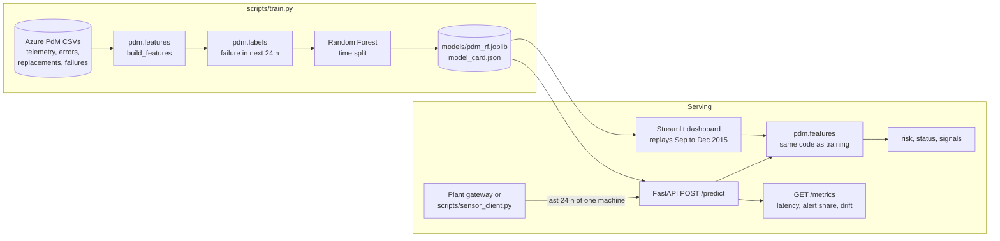

# Predictive Maintenance: failure risk in the next 24 hours

A model that warns a maintenance team before a machine fails, served by a REST API and a
dashboard that replays four months of plant data it never saw during training.

**Live demo:** [ISI: URL Streamlit Cloud]


## The problem

Unplanned downtime is the expensive kind: a part fails mid-shift, the line stops, and the
repair waits for a technician and a spare. Replacing parts on a fixed calendar wastes parts
that still had life in them. What a maintenance planner wants is a short list at the start of
each shift: which machines are likely to fail in the next day, and what looks wrong with them.

This project builds that list from the data a plant already records: hourly sensor readings,
the machine error log and the component replacement log.

## Results

Test period: September to December 2015, 100 machines, 225 failures. The model and its
thresholds were chosen on January to August only.

| Setup | PR-AUC | Precision | Recall | Alerts per machine per day | Failures caught |
|---|---|---|---|---|---|
| v1: label = the failure hour, random split, sensors only | 0.01 | 0.01 | 0.81 | 1.58 | not measured |
| v2: label = failure in next 24 h, time split, sensors only | 0.29 | 0.26 | 0.79 | 1.35 | 224 of 225 |
| **v2 shipped: + error counts and days since replacement** | **0.999** | **0.995** | **0.99** | **0.44** | **225 of 225** |

- *Failures caught*: at least one alert in the 24 hours before the failure. The first alert
  came a median 24 hours ahead.
- *Precision* is per machine-hour: 99.5% of alert hours were in the 24 hours before a real
  failure. Recall is the share of those pre-failure hours that were flagged.
- The first version of this project (v1) had a recall of 81%, but 99 of every 100 alerts were
  false. Its label marked only the hour of the failure itself, so the model learned to
  recognise a failure already happening. Its random split also put neighbouring hours of the
  same day in both train and test.
- Numbers come from `python scripts/train.py --compare` and are stored in
  [`models/model_card.json`](models/model_card.json).

**Read these numbers with the limits below.** The dataset is synthetic, and near-perfect
scores are a property of how it was generated, not something to expect on a real plant.

## How it works



1. **Features** (33): the four sensors, their 3 h and 24 h mean and standard deviation, the
   count of each error type in the last 24 h, the days since each component was last
   replaced, and the machine's age and model.
2. **Label**: 1 for every hour in the 24 hours before a failure.
3. **Split by time**: train Jan to Jun, validation Jul to Aug, test Sep to Dec, with a day
   dropped at each boundary so no training label looks into the next period.
4. **Thresholds** come from validation. *Alert* maximises F1. *Watch* is the lowest risk at
   which at least half of the flagged hours still precede a failure. On the test months,
   watch adds about 0.5 alerts per machine per day and catches the same 225 failures.
5. **Signals**: for each alert the API lists readings outside the training range (error
   counts, components past their 90th-percentile age, sensor means beyond the 1st or 99th
   percentile), ordered by feature importance. They point a technician at what to check. A
   Random Forest has no single cause for a score, so they are not explanations.

## API

```bash
uvicorn app.main:app --port 8000        # docs: http://localhost:8000/docs
curl -X POST localhost:8000/predict -H "Content-Type: application/json" \
     -d @docs/example_request.json
```

The client sends raw records of one machine, not pre-computed features:

```json
{
  "machine_id": 13, "model": "model1", "age": 15,
  "telemetry": [{"datetime": "2015-09-21T21:00:00", "volt": 194.943, "rotate": 468.3,
                 "pressure": 101.751, "vibration": 53.366}, "... 24 or more hourly readings"],
  "errors": [{"datetime": "2015-09-22T06:00:00", "error_id": "error5"}],
  "replacements": [{"datetime": "2015-09-08T06:00:00", "comp": "comp2"}, "... one per component"]
}
```

```json
{
  "machine_id": 13, "as_of": "2015-09-22T20:00:00", "risk": 0.9918, "status": "ALERT",
  "action": "Failure likely within 24 h. Inspect before the next shift.",
  "signals": ["error5 ×1 in 24 h"], "thresholds": {"alert": 0.555, "watch": 0.113},
  "model_version": "2.0.0"
}
```

| Endpoint | What it returns |
|---|---|
| `POST /predict` | risk, status (`ALERT`, `WATCH`, `OK`), action, signals |
| `GET /health` | `ok` with the model version, or `degraded` when the model is missing |
| `GET /model-info` | the model card: data periods, thresholds, test metrics |
| `GET /metrics` | p50/p95 latency, status share and input drift (PSI) of this process |

Requests with fewer than 24 hours, gaps in the hourly readings, an unknown machine model or a
component without a replacement date get a 422 that says what is wrong. A missing model gives
503, not 500.

## Run it

Python 3.12 or newer.

```bash
pip install -r requirements-dev.txt
streamlit run app/dashboard.py          # dashboard, uses the committed model and replay data
pytest                                  # 21 tests
```

With Docker:

```bash
docker compose up --build               # API on :8000, dashboard on :8501
python scripts/sensor_client.py         # replay machine 13 against the API, then print /metrics
```

Retrain from the raw data (about 80 MB, not committed):

```bash
python scripts/download_data.py         # into data/raw/
python scripts/train.py --compare       # about 3 minutes on 2 CPU cores
```

## Decisions and trade-offs

- **One feature function for training and serving.** `pdm.features.build_features` runs over
  a year of history in training and over a 24 hour request in the API. A test checks that
  both give the same numbers for 25 random machine-hours. v1 had a schema without the machine
  model field, and the server filled those columns with 0; on the demo data that moved the
  risk by up to 0.77 and changed the status of 11 of 500 rows. The cost is speed: building
  features with pandas takes about 44 ms per request, the model itself about 4 ms. A NumPy
  version would be faster but would be a second implementation to keep in sync.
- **Raw records in the request, not features.** The client does not need to know how rolling
  windows are computed, and the server can validate what it gets (hourly, no gaps, every
  component known).
- **Random Forest.** The saved model is 0.7 MB, predicts one row in about 4 ms, and gives
  per-feature importances. On this data it is already near perfect, so a gradient-boosted
  model or an LSTM could not show a gain; for a sensors-only plant it is the next thing to try.
- **Thresholds from a validation period, metrics from a later test period.** Choosing the
  threshold on test data would make the test numbers optimistic.
- **Alerts per machine per day is reported next to precision and recall.** It is what a
  maintenance team feels: v1 would have sent about 158 alerts a day for 100 machines.
- **Monitoring is in-process.** `/metrics` and the dashboard's Health tab keep the last 5,000
  predictions in memory. That is enough to see latency, alert share and drift after a
  release. A real deployment would export the same numbers to Prometheus.
- **Drift needs a week of data.** Hourly readings of one machine move together, so PSI over
  a few days swings by chance (up to 0.13 over 7 days of the replay, under 0.07 over 14).
  The dashboard uses the last 14 days and reports nothing before day 7.
- **The dashboard scores in-process** instead of calling the API, so the public demo runs on
  Streamlit Community Cloud without a second service. Both use the same `pdm` package.

## Limitations

- The Azure Predictive Maintenance dataset (published by Microsoft in the Azure AI Gallery;
  [mirror](https://github.com/ashishpatel26/Predictive_Maintenance_using_Machine-Learning_Microsoft_Casestudy/tree/master/data))
  is **synthetic**: 100 machines, one year, four component types. Its errors were generated to
  precede failures, which is why error counts are the strongest features and the scores are
  near perfect. Sensors alone reach a PR-AUC of 0.29. Expect lower numbers on real data.
- Alerts start a median 24 hours ahead because the label is 24 hours. A longer horizon would
  give earlier but less precise warnings.
- The model needs the error and replacement logs. A plant without them gets the sensors-only
  result above.
- Thresholds were chosen for F1. A plant should re-choose them from its own cost of a missed
  failure against the cost of an unnecessary inspection.
- The replay set has 12 machines (9 with failures, 3 without) to keep the repository small.

## Project layout

```
pdm/                 shared package: features, labels, model bundle, monitoring, data loading
app/main.py          FastAPI service           app/schemas.py   request and response models
app/dashboard.py     Streamlit dashboard       .streamlit/      theme
scripts/train.py     training and model card   scripts/download_data.py, sensor_client.py
models/              pdm_rf.joblib, model_card.json
data/replay/         test-period data of 12 machines (demo and tests)
tests/               features, API and model tests
notebooks/           v1 exploration, kept for reference; superseded by scripts/train.py
Dockerfile           API image (non-root, health check)   Dockerfile.dashboard, docker-compose.yml
.github/workflows/   lint, tests, image build and smoke test
```

The dashboard follows plant control-room display practice (ISA-101): grey background, colour
only for abnormal states, a shape next to every status so it does not depend on colour, and
readings shown against their normal range.
