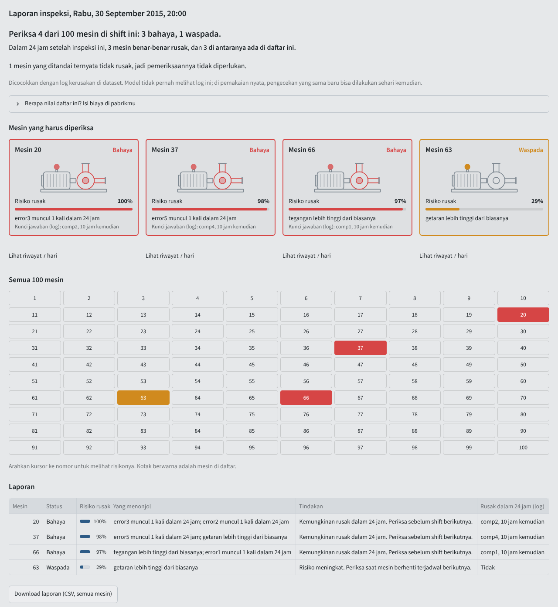
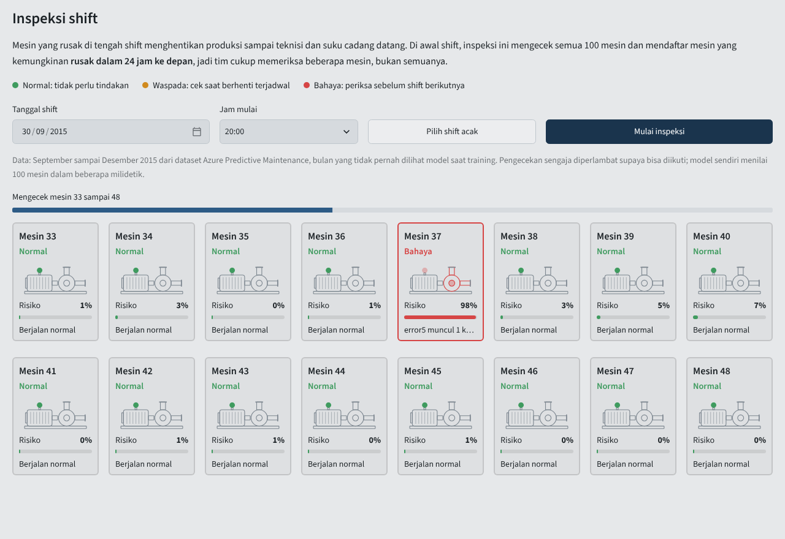
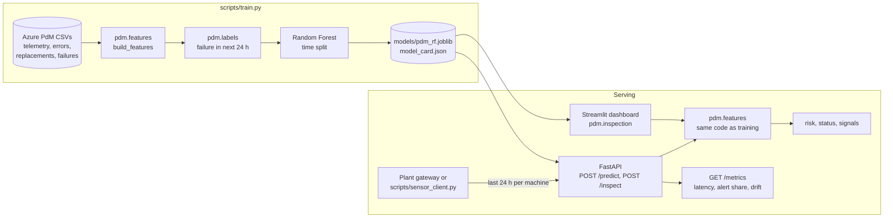
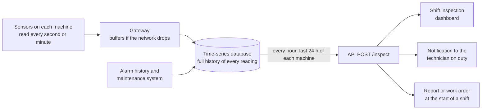

# Predictive Maintenance: which machines to inspect this shift

A shift inspection for a fleet of 100 machines. It checks every machine, lists the few likely
to break down in the next 24 hours, and says what stands out on each. Behind it are a model
trained on a year of sensor, error and repair records, a REST API, Docker images and
monitoring.

**Live demo:** [ISI: URL Streamlit Cloud]



## The problem

A machine that breaks down mid-shift stops the line until a technician and a spare part
arrive. The plant pays for the repair, the lost production and often overtime to catch up.
Inspecting every machine every shift is too slow, and replacing parts on a fixed calendar
throws away parts that still had life in them.

What a maintenance planner needs at the start of a shift is a short list: which machines are
likely to fail in the next day, and what looks wrong with them. This project builds that list
from data a plant already records: hourly sensor readings, the machine error log and the
component replacement log.

## Using it

The dashboard is in Indonesian, for the maintenance team that would use it; the code, the API
and this README are in English.

1. **Inspeksi** (shift inspection, the main view). Pick a shift, or press *Pilih shift acak*
   for a random one, then *Mulai inspeksi*. Machines 1 to 16 are checked, then 17 to 32, and
   so on up to 100.
   
   The report says how many machines to inspect, shows them, colours them on a map of all
   100, and checks the list against the dataset's failure log: how many machines really broke
   down in the next 24 hours and how many of them were on the list. Enter your own cost of a
   breakdown and of an inspection to see what the list is worth; no cost is assumed. The
   report downloads as CSV.
2. **Riwayat mesin** (machine history). The history of one machine **up to the hour of the
   inspection**, as a planner would see it at that moment: its risk over the last 7 days, the
   error codes and replacements, and its sensor readings against their normal range. It can
   be stepped back hour by hour but never past the inspection hour.
3. **Seberapa akurat?** The test results below and the limits of the data.
4. **Kesehatan sistem** (system health). Accuracy of the inspections run in this session,
   model time per machine, a scaling test for 100 to 10,000 machines, and input drift.

The data shown is September to December 2015, which the model never saw in training.

**What is prediction and what is not.** At every hour the model uses only the 24 hours
before it and returns one number, the probability of a breakdown in the next 24 hours. That
number is the prediction. *Riwayat mesin* stops at the inspection hour, so it shows only
what a planner could know at that moment. Because this is replayed history, the inspection
report can also look up what really happened in the next 24 hours: the *Kunci jawaban*
("answer key") line on each flagged machine and the check under the report's headline. They
exist only to show whether the predictions were right. In live use the future has not
happened yet, so the same check can only be made a day later.

## Results

Test period: September to December 2015, 100 machines, 225 failures. The model and its
thresholds were chosen on January to August only.

| Setup | PR-AUC | Precision | Recall | Alerts per machine per day | Failures caught |
|---|---|---|---|---|---|
| v1: label = the failure hour, random split, sensors only | 0.01 | 0.01 | 0.81 | 1.58 | not measured |
| v2: label = failure in next 24 h, time split, sensors only | 0.29 | 0.26 | 0.79 | 1.35 | 224 of 225 |
| **v2 shipped: + error counts and days since replacement** | **0.999** | **0.995** | **0.99** | **0.44** | **225 of 225** |

- *Failures caught*: at least one alert in the 24 hours before the failure. The first alert
  came a median 24 hours ahead.
- *Precision* is per machine-hour: 99.5% of alert hours were in the 24 hours before a real
  failure. Recall is the share of those pre-failure hours that were flagged.
- An inspection at a random hour of the test period flags on average 1.8 machines as alert
  and 2.2 as watch out of 100; 80% of hours have at least one alert.
- The first version of this project (v1) had a recall of 81%, but 99 of every 100 alerts were
  false. Its label marked only the hour of the failure itself, so the model learned to
  recognise a failure already happening. Its random split also put neighbouring hours of the
  same day in both train and test.
- Numbers come from `python scripts/train.py --compare` and are stored in
  [`models/model_card.json`](models/model_card.json).

**Read these numbers with the limits below.** The dataset is synthetic, and near-perfect
scores are a property of how it was generated, not something to expect on a real plant.

## How it works



1. **Features** (33): the four sensors, their 3 h and 24 h mean and standard deviation, the
   count of each error type in the last 24 h, the days since each component was last
   replaced, and the machine's age and model.
2. **Label**: 1 for every hour in the 24 hours before a failure.
3. **Split by time**: train Jan to Jun, validation Jul to Aug, test Sep to Dec, with a day
   dropped at each boundary so no training label looks into the next period.
4. **Thresholds** come from validation. *Alert* maximises F1. *Watch* is the lowest risk at
   which at least half of the flagged hours still precede a failure. On the test months,
   watch adds about 0.5 alerts per machine per day and catches the same 225 failures.
5. **Signals**: for each flagged machine, readings outside the training range (error counts,
   components past their 90th-percentile age, sensor means beyond the 1st or 99th
   percentile), ordered by feature importance. They point a technician at what to check. A
   Random Forest has no single cause for a score, so they are not a diagnosis.
6. **Inspection** (`pdm.inspection`): score every machine at one hour, sort by status and
   risk, and, when the failure log is known, check each finding against the next 24 hours.

## API

```bash
uvicorn app.main:app --port 8000        # docs: http://localhost:8000/docs
curl -X POST localhost:8000/predict -H "Content-Type: application/json" \
     -d @docs/example_request.json
```

The client sends raw records of one machine, not pre-computed features:

```json
{
  "machine_id": 13, "model": "model1", "age": 15,
  "telemetry": [{"datetime": "2015-09-21T21:00:00", "volt": 194.943, "rotate": 468.3,
                 "pressure": 101.751, "vibration": 53.366}, "... 24 or more hourly readings"],
  "errors": [{"datetime": "2015-09-22T06:00:00", "error_id": "error5"}],
  "replacements": [{"datetime": "2015-09-08T06:00:00", "comp": "comp2"}, "... one per component"]
}
```

```json
{
  "machine_id": 13, "as_of": "2015-09-22T20:00:00", "risk": 0.9918, "status": "ALERT",
  "action": "Failure likely within 24 h. Inspect before the next shift.",
  "signals": ["error5 logged once in 24 h"], "thresholds": {"alert": 0.555, "watch": 0.113},
  "model_version": "2.0.0"
}
```

| Endpoint | What it does |
|---|---|
| `POST /predict` | one machine: risk, status (`ALERT`, `WATCH`, `OK`), action, signals |
| `POST /inspect` | up to 500 machines in one call (`{"machines": [...]}`): every prediction, alert first, and a summary of how many to inspect |
| `GET /health` | `ok` with the model version, or `degraded` when the model is missing |
| `GET /model-info` | the model card: data periods, thresholds, test metrics |
| `GET /metrics` | p50/p95 latency, status share and input drift (PSI) of this process |

Requests with fewer than 24 hours, gaps in the hourly readings, an unknown machine model, a
component without a replacement date or the same machine twice get a 422 that says what is
wrong. A missing model gives 503, not 500.

## Run it

Python 3.12 or newer.

```bash
pip install -r requirements-dev.txt
streamlit run app/dashboard.py          # dashboard, uses the committed model and replay data
pytest                                  # 27 tests
```

With Docker:

```bash
docker compose up --build               # API on :8000, dashboard on :8501
python scripts/sensor_client.py         # replay machine 13 against the API, then print /metrics
```

Retrain from the raw data (about 80 MB, not committed):

```bash
python scripts/download_data.py         # into data/raw/
python scripts/train.py --compare       # about 3 minutes on 2 CPU cores
```

## Release and monitoring

| Option | How | When it fits |
|---|---|---|
| Cloud | The dashboard on Streamlit Community Cloud (the live demo); the API image on any container host | A demo, or plants that already send data to the cloud |
| On-premise | `docker compose up` on a server inside the plant network; the API image runs as a non-root user with a health check | Plants that keep production data inside their network |
| Edge | The model file is 0.7 MB and runs on one CPU core, so the API fits an industrial PC or gateway next to the machines | Sites with a weak connection, or alerts that must not depend on one |

Measured costs:

- One `/predict` call takes about 45 ms. About 44 ms of that is building features from raw
  records; the model takes about 4 ms.
- `/inspect` builds the features of all machines in one pass. For 100 machines it takes about
  0.25 s, against about 4.8 s for 100 single `/predict` calls.
- Inside the dashboard the features are already built, so scoring 100 machines takes a few
  milliseconds. *System health* measures 100, 1,000 and 10,000 machines on the computer that
  runs it.

After a release, *System health* and `/metrics` show:
- latency (p50 and p95);
- the share of alerts;
- input drift (PSI of the 24 h sensor means against the training months);
- in the dashboard, how many breakdowns the inspections caught.

## Decisions and trade-offs

- **Batch inspection as the main view, streaming as the drill-down.** Maintenance teams plan
  by shift, so a list at the start of a shift is something they can use every day. The
  hour-by-hour replay is kept in *Machine history* for explaining one machine.
- **`/inspect` next to `/predict`.** Building features dominates the cost of a request, and
  it is vectorised across machines. One call for the fleet is about 19 times faster than one
  call per machine.
- **One feature function for training and serving.** `pdm.features.build_features` runs over
  a year of history in training and over a 24 hour request in the API. A test checks that
  both give the same numbers for 25 random machine-hours.
  - v1 had a schema without the machine model field, and the server filled those columns
    with 0. On the demo data that moved the risk by up to 0.77 and changed the status of 11
    of 500 rows.
  - A NumPy version would be faster, but it would be a second implementation to keep in sync.
- **Raw records in the request, not features.** The client does not need to know how rolling
  windows are computed, and the server can validate what it gets (hourly, no gaps, every
  component known).
- **Random Forest.** The saved model is 0.7 MB, predicts one row in about 4 ms, and gives
  per-feature importances. On this data it is already near perfect, so a gradient-boosted
  model or an LSTM could not show a gain. For a sensors-only plant it is the next thing to
  try.
- **Thresholds from a validation period, metrics from a later test period.** Choosing the
  threshold on test data would make the test numbers optimistic.
- **Alerts per machine per day is reported next to precision and recall.** It is what a
  maintenance team feels: v1 would have sent about 158 alerts a day for 100 machines.
- **No cost is assumed.** The value of an inspection list depends on the plant's own cost of a
  breakdown and of an inspection, so the dashboard asks for both instead of quoting a saving.
- **Monitoring is in-process.** `/metrics` and *System health* keep the last 5,000
  predictions in memory. That is enough to see latency, alert share and drift after a
  release. A real deployment would export the same numbers to Prometheus.
- **Drift needs a week of data.** Hourly readings of one machine move together, so PSI over
  a few days swings by chance. Over 12 replayed machines it reached 0.13 over 7 days and
  stayed under 0.07 over 14. The dashboard uses the last 14 days and reports nothing before
  day 7.
- **The dashboard scores in-process** instead of calling the API, so the public demo runs on
  Streamlit Community Cloud without a second service. Both use the same `pdm` package.

## From this simulation to a real plant

This project is a simulation. It shows that the model, the API and the inspection flow work
end to end, on a public dataset that has the same structure as plant records. Deploying it
in a company means collecting that plant's own data:

- **Newer machines** already expose sensor readings and alarms through their controllers
  (PLC or SCADA) or a plant historian. The data can be read from there directly.
- **Older machines** often have no such output. They need retrofitted IoT sensors (vibration,
  current or voltage, pressure) and a gateway that forwards hourly readings. That hardware
  and its installation cost money, and the case for it rests on comparing that cost with what
  one unplanned breakdown of a critical machine costs in repairs and lost production.
- **Error and replacement logs** come from the machines' alarm history and the maintenance
  system (CMMS or work orders). The model relies on them heavily (see the limits below), so
  they matter as much as the sensors.

Field data is messier than this dataset, which has no missing hours, frozen sensors, spikes
or duplicate timestamps. Before training on a real plant's data, the pipeline needs:
- a cleaning step that fills short gaps, drops readings stuck at one value, clips physical
  outliers and removes duplicates;
- the same rules applied in the API, which today rejects incomplete requests with a 422
  instead of repairing them.

The model then has to be retrained and its thresholds chosen again on that plant's own
history.

### How it would run in a plant



- Sensors record around the clock and the database keeps everything, so the history keeps
  growing. Nobody presses a button: a scheduled job sends the last 24 hours of every machine
  to `/inspect` every hour. The *Mulai inspeksi* button in the demo stands in for that job.
- Each check reads the current state together with the 24 hours before it. A breakdown shows
  up as a change over hours (vibration creeping up, errors becoming frequent), not in one
  reading.
- The answer is always about the next 24 hours, for example "machine 20, 98% risk, inspect
  before the next shift". The model does not give the exact hour of a breakdown and does not
  see the future. Whether an alert was right is known a day later, which is what the
  inspection report's log check imitates.

What a new installation means in practice:

- Sensors record only from the day they are installed. The first prediction needs 24 hours
  of readings.
- Training a model for that plant needs months of data that include several breakdowns. A
  model cannot learn the warning signs of a failure it has never seen. This, not the model,
  is usually the slowest part of a real project.
- Alarm and maintenance logs often go back years, before any sensor was fitted. They can be
  used from the start, and in this model they carry the most weight.
- Until enough data exists, plants usually run simple rules, for example an alarm when
  vibration passes the manufacturer's limit, and replace them with a trained model later.

## Limitations

- The Azure Predictive Maintenance dataset (published by Microsoft in the Azure AI Gallery;
  [mirror](https://github.com/ashishpatel26/Predictive_Maintenance_using_Machine-Learning_Microsoft_Casestudy/tree/master/data))
  is **synthetic**: 100 machines, one year, four component types.
  - Its errors were generated to precede failures. That is why error counts are the strongest
    features and why the scores are near perfect.
  - Sensors alone reach a PR-AUC of 0.29. Expect lower numbers on real data.
  - It is clean, so the cleaning step described above has not been built or measured.
  - Component and machine-model names are anonymised (`comp1` to `comp4`, `model1` to
    `model4`), and no units are given for pressure and vibration, so the dashboard shows
    those two without a unit.
- Alerts start a median 24 hours ahead because the label is 24 hours. A longer horizon would
  give earlier but less precise warnings.
- The model needs the error and replacement logs. A plant without them gets the sensors-only
  result above.
- Thresholds were chosen for F1. A plant should re-choose them from its own cost of a missed
  failure against the cost of an unnecessary inspection.
- The breakdown check in the inspection report uses the dataset's failure log, which exists
  only because this is replayed history. In live use, the same check runs a day later.

## Project layout

```
pdm/                 shared package: features, labels, model bundle, inspection, monitoring, data
app/main.py          FastAPI service           app/schemas.py   request and response models
app/dashboard.py     Streamlit dashboard       .streamlit/      theme
scripts/train.py     training and model card   scripts/download_data.py, sensor_client.py
models/              pdm_rf.joblib, model_card.json
data/replay/         test-period data of all 100 machines (dashboard and tests, about 5 MB)
tests/               features, API, inspection, model and dashboard tests
notebooks/           v1 exploration, kept for reference; superseded by scripts/train.py
Dockerfile           API image (non-root, health check)   Dockerfile.dashboard, docker-compose.yml
.github/workflows/   lint, tests, image build and smoke test
```

The dashboard borrows from plant control-room displays (ISA-101):
- a grey background, with colour kept for the status lamp and for the outline of machines
  that need attention;
- every status also written as a word, so it never depends on colour alone;
- readings shown against their normal range;
- machines always in the same place, sorted by ID, so a red one is easy to find again.
